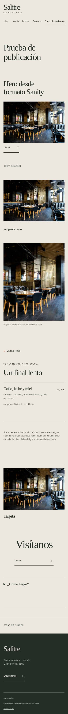

# Cierre de fase 1 — revisión desde el móvil

Fecha: 30 de octubre de 2026. No se ha integrado ninguna PR, publicado Studio, escrito en Sanity ni desplegado ninguna web durante esta revisión.

**Dictamen:** lista técnicamente para integrar ambas PR, con CI correcto y compatibilidad comprobada. La prueba editorial completa «crear/publicar una página desde el Studio actualizado → reconstruir → verla en una URL de ensayo» queda pendiente de autorizar un entorno aislado. No se presenta una simulación como si fuera una publicación real.

## 1. Estado de las PR y Actions

| Repositorio | PR | Validación del código de fase 1 |
| --- | --- | --- |
| Frontend | [#4](https://github.com/EduardoCR90/restaurant-premium-sanity/pull/4) | [Actions 41100227312: success](https://github.com/EduardoCR90/restaurant-premium-sanity/actions/runs/41100227312) |
| Studio | [#3](https://github.com/EduardoCR90/studio-salitre-restaurant/pull/3) | [Actions 41100230312: success](https://github.com/EduardoCR90/studio-salitre-restaurant/actions/runs/41100230312) |

Las dos PR estaban abiertas, en borrador y sin conflictos al revisar. Los enlaces anteriores acreditan los commits de código `45e2472` y `7098c1e`. Este cierre añade documentación y capturas; antes de integrar, comprueba también los checks del último commit en la pestaña **Checks** de cada PR. No extrapoles un resultado de CI a otra revisión.

Se consultaron las cinco ejecuciones más recientes de cada repositorio: todas completadas con success. Incluyen el último Pages de main y la importación inicial histórica. No se ha vuelto a ejecutar esa importación ni un workflow de despliegue.

## 2. Qué se ha comprobado

- Frontend: `check` sin errores/avisos, 14 tests aprobados, build contra Sanity real, `check:build` y `check:cms` correctos.
- Studio: `check`, seis tests y build correctos.
- 22 documentos: una configuración, cuatro páginas, cuatro categorías, once platos, una historia y una galería. Los campos originales consultados coinciden con la instantánea de inicio de fase; se guardó además un inventario de IDs/revisiones y huella de los documentos durante el cierre.
- Las cuatro rutas públicas responden HTTP 200: portada, carta, restaurante y reservas. No se ha modificado la web pública.
- Prueba adicional con documentos en formato real de Sanity: evaluación de la consulta GROQ, referencias y assets, contratos Zod, resolución de los diez bloques, navegación de una página nueva y exclusión al ocultarla. No solo se probaron objetos ya normalizados.
- Build aislada de esa página de ensayo: rutas, enlaces, canonical, assets, anclas y 404 correctos. No se creó ningún documento de prueba en Sanity.
- Chromium a 390, 768 y 1440 px: cinco páginas (cuatro actuales y una simulada), imágenes cargadas, un h1, ausencia de desbordamiento horizontal y errores JS. En la página simulada: FAQ y navegación hacia la carta funcionan.

No se detectaron regresiones en esas comprobaciones. La comparación de la fase anterior ya acreditó textos y geometría originales idénticos en los tres tamaños. No se afirma haber medido Lighthouse/Core Web Vitals, todas las combinaciones de tema, lector de pantalla o la edición real en el Studio nuevo.

### Compatibilidad y límites que hay que conocer

- Los ocho tipos originales y los tres IDs singleton se conservan. Ninguna migración es obligatoria.
- Los documentos sin campos nuevos se adaptan con defaults. El frontend debe publicarse antes de usar los campos nuevos desde Studio.
- Los bloques están embebidos en page y el tema en settings: no cambia el contrato ni la lista de tipos del webhook.
- **Añadir el primer bloque a una página original sustituye su composición completa.** No hacerlo en la portada real como prueba. Sus campos antiguos no se borran, pero dejan de formar esa composición mientras haya bloques.
- Oculta retira la ruta. «No mostrar en el menú» solo retira el enlace del menú. Noindex no protege ni oculta una página.
- Los CTAs manuales pueden apuntar a una página posteriormente oculta; `check:build` impide publicar esos enlaces rotos. Los enlaces automáticos de las composiciones se retiran correctamente.
- Los avisos con fechas cambian al reconstruir, no al pasar la hora por sí solos.
- Las listas anidadas se aplanan a un nivel. Solo se implementa el tema inicial, con variantes compatibles. Los colores personalizados necesitan revisión de contraste.
- La autorización de módulos no procede del CMS. No se han implementado módulos de pago ni funcionalidades de fase 2.

## 3. Vista previa que puedes abrir ahora desde el móvil

Estas son **capturas reales de navegador**, alojadas como archivos de documentación en la rama de la PR. GitHub las muestra al abrir este documento; no hay que descargar un ZIP ni instalar herramientas. No son un despliegue ni una web navegable. Puedes tocar cada enlace para ampliar la imagen.

| Página | Abrir captura |
| --- | --- |
| Inicio con contenido actual | [Inicio móvil](phase-1-review/inicio-movil.jpg) |
| Carta con contenido actual | [Carta móvil](phase-1-review/carta-movil.jpg) |
| Restaurante con contenido actual | [Restaurante móvil](phase-1-review/restaurante-movil.jpg) |
| Reservas con contenido actual | [Reservas móvil](phase-1-review/reservas-movil.jpg) |
| Página nueva simulada, diez bloques | [Prueba de bloques móvil](phase-1-review/validacion-fase-1-movil.jpg) |

La quinta captura usa una copia en memoria de la lectura pública y añade una página únicamente a la build de ensayo. Reutiliza una imagen y referencias existentes sin cambiarlas. La ruta validacion-fase-1 no se ha publicado en la web actual.

También existen los artefactos salitre-static-review y salitre-studio-build en las ejecuciones de Actions anteriores. Son descargas temporales de CI; no son URLs de hosting y no sustituyen la revisión editorial.

Una vista previa interactiva externa requiere alojar una build. No se ha activado porque has reservado la autorización de los despliegues. No se reutiliza el Pages de producción como supuesto entorno de ensayo.

## 4. Estrategia para publicar una página desde Sanity sin tocar la web actual

### Preparación aislada — requiere autorización posterior

Se recomienda un **proyecto Sanity de ensayo independiente**, para que sus publicaciones no puedan activar el webhook de hfa8zkyw/production. Un dataset distinto dentro del proyecto actual sería una alternativa si no hay cuota para otro proyecto, pero exige revisar antes el alcance real del webhook. No se ha creado ninguno de los dos.

1. Autoriza la preparación de ese entorno desde este chat. Codex puede ejecutar el trabajo en la nube: no necesitas ordenador ni terminal.
2. Crear proyecto de ensayo y dataset phase1-review; registrar su ID, permisos y propietario. Usar credenciales propias del ensayo. Los tokens se guardan mediante Sanity Manage/GitHub Secrets, nunca en el chat, código o variables públicas.
3. Copiar la instantánea pública de las 22 entradas y sus imágenes **solo al destino nuevo**. Conservar IDs/referencias dentro de esa copia. Comprobar destino antes de escribir. No ejecutar seed:import sobre production ni usar una importación con reemplazo contra el proyecto real.
4. Preparar un Studio de revisión a partir de la PR #3, apuntando exclusivamente al nuevo proyecto/dataset, con hostname diferente. Mostrar claramente «ENSAYO» en el título. No usar sin cambios el workflow Publish standalone Sanity Studio actual: fija el proyecto de producción.
5. Preparar un frontend de revisión a partir de la PR #4, apuntando al mismo proyecto/dataset, con SANITY_USE_MOCK=false y SANITY_ALLOW_DEMO_FALLBACK=false. El token privado de lectura solo está en build. La build debe acreditar fuente sanity y fallar ante contenido incompleto.
6. Alojamiento independiente: una web/repositorio de revisión distinto, URL de ensayo, SITE_URL/SITE_BASE propios y sin permisos de escritura sobre Pages de producción. No basta con seleccionar otra rama del workflow actual: deploy.yml solo publica main y usa el mismo sitio Pages.
7. Someter configuración, destinos y permisos concretos a revisión antes de publicar Studio o web de ensayo. Esos despliegues también necesitan tu autorización. No crear un webhook nuevo hasta revisar su destino y alcance.

La copia inicial es una operación de ensayo, no una migración del dataset real. Si no se dispone de permisos/credenciales de ensayo, hay que detener esa parte; los tests con fixtures no la sustituyen.

### Prueba editorial desde tu móvil

Con Studio y web de ensayo publicados y autorizados:

1. Abre la URL de Studio marcada ENSAYO e inicia sesión. Comprueba proyecto/dataset antes de editar.
2. En Páginas y navegación, crea una página nueva llamada «Validación fase 1», slug validacion-fase-1. Rellena SEO; marca Noindex y mantenla oculta mientras preparas el contenido.
3. Añade hero, texto enriquecido, imagen/texto, galería, carta con una categoría/plato referenciados, tarjetas, CTA, FAQ, separador y aviso. Arrastra dos bloques para cambiar el orden. Usa imágenes copiadas, con alt.
4. Guarda primero solo como borrador: la build publicada de ensayo no debe generar la ruta ni el enlace. Una build del contenido publicado debe seguir mostrando los 22 documentos originales copiados.
5. Publica manteniendo la página oculta y reconstruye **solo el frontend de ensayo**. Habrá 23 documentos de contenido, pero no debe aparecer la ruta ni su enlace.
6. Cambia su estado a Publicada, activa Mostrar en menú, etiqueta «Prueba» y orden 5. Publica. Ejecuta la build de ensayo y, tras autorizar su actualización, abre su URL desde el móvil.
7. Verifica ruta nueva, menú activo, orden de bloques, CTA, FAQ, alt, responsive, metadatos y noindex. El sitemap debe excluir esa página mientras Noindex esté activo.
8. Desactiva Mostrar en menú: la ruta debe seguir accesible tras reconstruir. Oculta la página: después de reconstruir, ruta ausente/404 y sin enlace en el menú.
9. En la copia de carta, oculta un plato y marca otro no disponible: uno debe desaparecer y el otro seguir visible como agotado. Revierte estos cambios únicamente en el ensayo.
10. Si se quiere probar el ciclo automático, crear un webhook ligado solo al dataset de ensayo y a su workflow/repositorio de revisión. La primera prueba puede usar una reconstrucción manual; no demuestra el webhook.
11. Comparar de nuevo los 22 IDs/revisiones del proyecto real, sin escrituras. Volver a abrir las cuatro URLs públicas y verificar que no se ha publicado la ruta validacion-fase-1 en producción.

No probar la publicación en production con una página «fuera del menú»: seguiría siendo pública por URL y podría activar el webhook. Tampoco desactivar el webhook real para ensayar, porque alteraría el servicio actual.

## 5. Integración y despliegue desde GitHub en el móvil

**Estos pasos son el procedimiento pendiente, no instrucciones para ejecutarlos antes de autorizar.** No se ha cambiado la protección de ramas, secretos ni entornos.

### A. Antes de integrar

1. Revisar PR #4 y #3, este informe, las capturas y Checks del último commit. Si GitHub móvil oculta controles, usar el navegador con «Sitio de escritorio».
2. Si necesitas cerrar la aceptación editorial antes de integrar, completar la prueba aislada anterior. Falta autorización y configuración de ese entorno.
3. Autorizar por separado la integración/publicación. **Integrar la PR #4 ya activa automáticamente el despliegue público existente.** No es un paso de integración inocuo que se pueda hacer sin autorizar la publicación.
4. No modificar variables ni volver a introducir secretos que ya funcionen. No se necesita cambiar el webhook ni migrar las 22 entradas.

### B. Primero frontend #4

1. Abre la PR #4. Usa Ready for review cuando se apruebe su revisión; confirma que la base sea main y que los checks estén verdes.
2. Solo con autorización, integra mediante el método que permita GitHub. No hacer force-push ni saltarse comprobaciones.
3. Abre Actions → Deploy demo to GitHub Pages y entra en la ejecución del nuevo commit de main. La integración dispara ese workflow; no ejecutar Run workflow otra vez si ya está en curso.
4. Espera a build y deploy correctos. Si github-pages exige aprobación de entorno, autorízala desde esa ejecución.
5. Abre https://eduardocr90.github.io/restaurant-premium-sanity/ y navega a carta, restaurante y reservas. Verifica contenido, imágenes y enlaces. No añadir todavía bloques a las páginas reales.
6. Si falla build, no seguir con Studio. El despliegue anterior permanece; revisar el error antes de reintentar. Si ya publicó y hay una regresión, preparar una PR de reversión y autorizar su integración: no borrar contenido del CMS.

### C. Después Studio #3

1. Cuando el frontend actualizado esté publicado y comprobado, revisa Checks del último commit de la PR #3, márcala Ready for review e intégrala solo con autorización.
2. Integrar Studio ejecuta su CI; **no publica Studio automáticamente**. La publicación sigue siendo manual.
3. Abre el repositorio Studio → Actions → Publish standalone Sanity Studio → Run workflow → rama main. Este workflow usa hfa8zkyw/production. Es un despliegue real del Studio y de sus schemas y necesita autorización.
4. El workflow ejecuta check, schemas deploy y deploy, y verifica la URL. No ejecuta seed:import ni migraciones de contenido. Usa el secreto SANITY_AUTH_TOKEN y el hostname existentes; no pegues tokens en el móvil/chat.
5. Abre el Studio en la URL que acredite esa ejecución. Confirma los tres singletons y los 22 documentos; navega por las seis secciones y comprueba los estados de los platos.
6. Revisa primero sin editar. La posterior publicación de contenido en el CMS puede activar el webhook de producción. No publicar pruebas en ese dataset.
7. Si una publicación de Studio falla, revisa el log antes de reintentar. La publicación del schema podría haber terminado aunque la del Studio falle; no asumir un rollback automático de ambos. El cambio de schemas es aditivo y no migra los documentos.

### D. Cierre operativo

1. Confirmar frontend y Studio publicados, contenido conservado y las dos PR integradas.
2. Realizar la prueba editorial en ensayo y el ciclo de webhook de ensayo, si no se completaron antes.
3. Si se desea volver a comprobar el webhook real, aprobar explícitamente un cambio editorial válido en producción y su reconstrucción. No es necesario crear una página de prueba pública.
4. Registrar URLs, commits, ejecuciones y resultado; conservar una copia de contenido según la política de backups del proyecto.

## 6. Qué falta para fase 2

Puede empezar el diseño de fase 2 con estos contratos. Antes de ampliar funcionalidades conviene cerrar la aceptación editorial aislada y la entrega autorizada de fase 1.

La fase 2 necesita decisiones y trabajo nuevos: identidad de restaurante y usuarios, backend, permisos por servidor, autorización de contratación, auditoría y estrategia de sincronización con Sanity. Después elegir un primer módulo concreto y sus criterios de aceptación. Las preferencias de Sanity no son permisos de pago. No se han elegido ni creado servicios de autenticación, facturación o Supabase durante este cierre.
